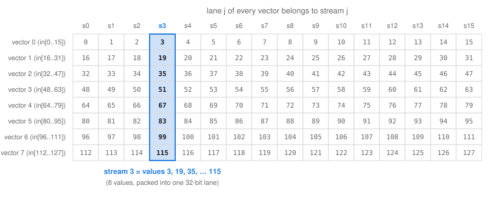
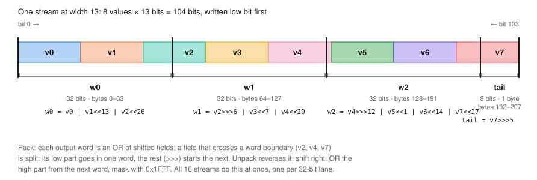
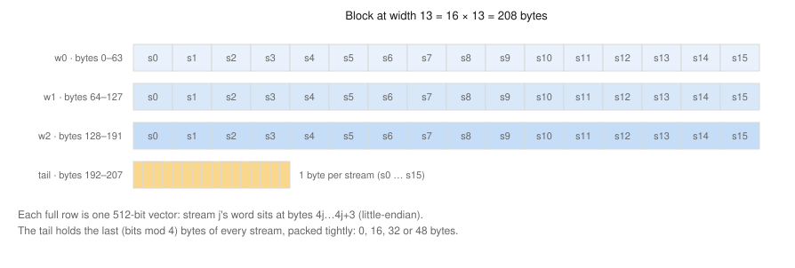
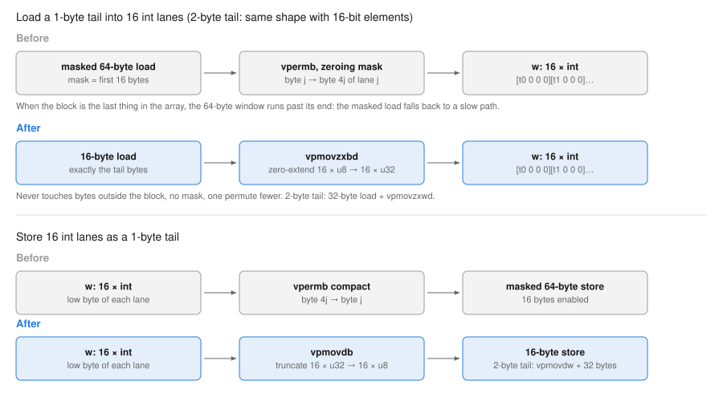
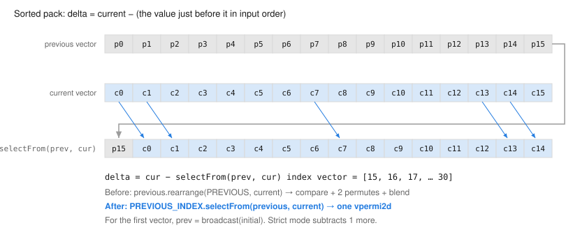
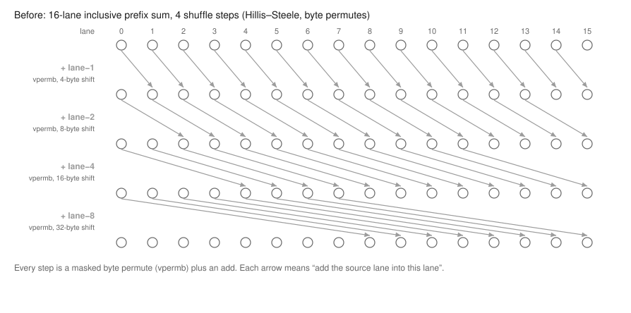
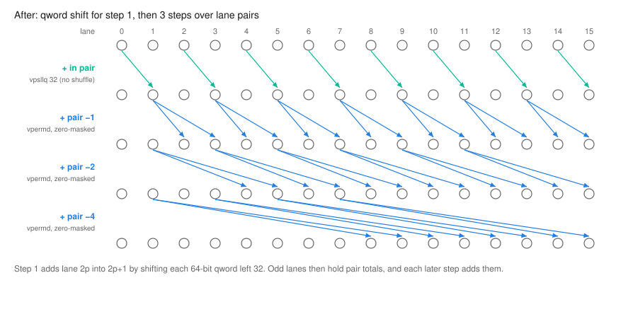
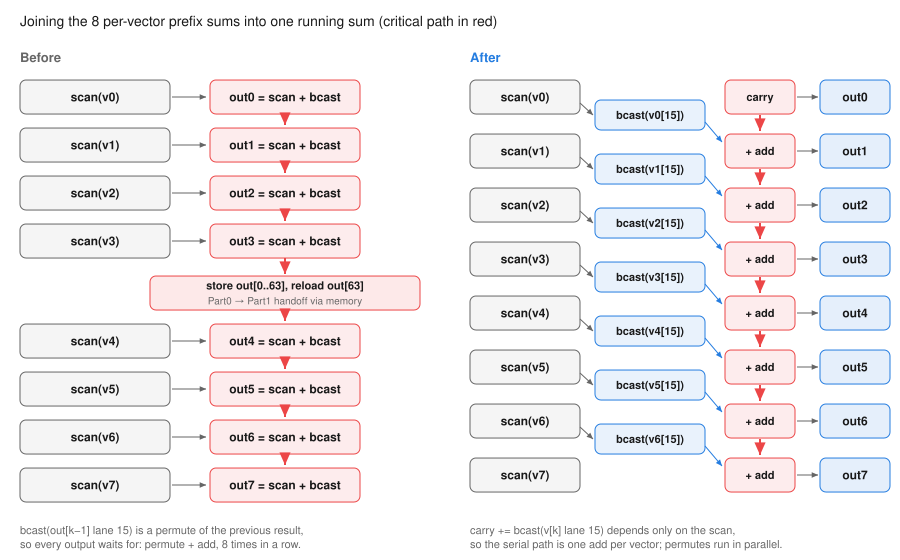
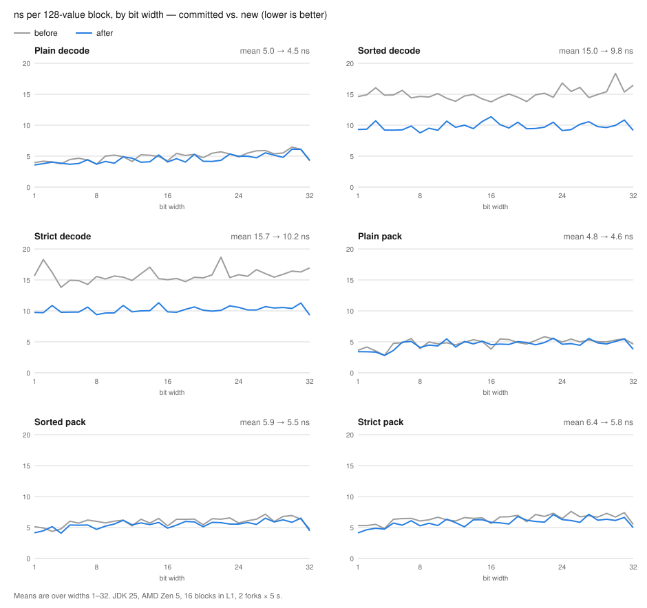

# How the AVX-512 kernels work, and what changed

This note explains how `Vector512Kernels` packs and unpacks a block, in plain
and sorted mode, and what the latest round of changes did to it. The encoded
format is unchanged: old and new kernels read and write identical bytes.

Short version of the changes:

| Change | Where | Effect (geomean over widths 1–32) |
|---|---|---|
| Prefix sum rebuilt; carry chain moved off the shuffle path | sorted / strict decode | **−35%** |
| `selectFrom` (one `vpermi2d`) instead of a two-vector `rearrange` | sorted / strict pack and width detection | pack −8…−10%, detect −13% |
| 1- and 2-byte tails loaded and stored with plain narrow moves | plain decode, all packs | −16…−18% on those widths |

---

## 1. The format

A block is 128 unsigned 32-bit integers packed at a bit width `b` (1–32). It
always takes `16 × b` bytes.

### Sixteen streams

The block is cut into 16 interleaved **streams**. Stream `j` holds values
`j, j+16, j+32, …, j+112`: eight values.



This choice is what makes the whole thing fast. Read the input 16 integers at a
time (one 512-bit vector) and each lane already belongs to its own stream. Lane
`j` of vector `k` is value `k` of stream `j`. Packing never moves data between
lanes. Every lane does an ordinary scalar bit-packing job, and AVX-512 runs 16
of them side by side.

### Bits of one stream

Each stream's 8 values are concatenated low bit first. That gives `8 × b` bits,
which is exactly `b` bytes. These bytes are split into `⌊b/4⌋` full 32-bit
words and a tail of `b mod 4` bytes.



### Bytes of a block

Word `m` of all 16 streams forms one 64-byte row. The row sits at byte offset
`64·m`, and within it stream `j` is at bytes `4j…4j+3`. The tail comes after the
last row. Every stream's tail bytes are packed tightly, so stream `j`'s tail
starts at byte `j × (b mod 4)` of the tail.



| `b mod 4` | Tail per stream | Tail size | Widths |
|---:|---:|---:|---|
| 0 | none | 0 B | 4, 8, 12, … 32 |
| 1 | 1 byte | 16 B | 1, 5, 9, … 29 |
| 2 | 2 bytes | 32 B | 2, 6, 10, … 30 |
| 3 | 3 bytes | 48 B | 3, 7, 11, … 31 |

Width 1 has no full words at all: the block is just a 16-byte tail. Width 32 has
no tail and no masking; it is a straight copy.

### Modes

| Mode | Methods | What gets packed |
|---|---|---|
| 0, plain | `compress`, `decompress` | the value itself |
| 1, sorted | `*Sorted` | `x[n] − x[n−1]` |
| 2, strictly sorted | `*StrictlySorted` | `x[n] − x[n−1] − 1` |

`x[−1]` is the caller's `initial` value. The deltas are taken in **input order**,
not within a stream, so the predecessor of value `16k+j` is value `16k+j−1`.
That value is in the neighbouring lane. This detail is why sorted mode needs
cross-lane work, as the sections below show.

The handwritten kernels are fully unrolled per width and per mode. There are 32 × 3 pack
methods and 32 × 3 unpack methods, so every shift amount and mask is a
constant.

### About the assembly snippets

The collapsible "Assembly" blocks below are excerpts of the C2 output for
width 13. They come from JDK 25.0.1 on Zen 5, with old (HEAD) and new kernels
compiled side by side. They are trimmed to the relevant instructions and keep
the real register names. Two things help when reading them:

- `[base + … + 0x10]`: the `0x10` skips the 16-byte Java array header. So
  `+0xd0` in a `byte[]` is byte 192 of the block, and `+0x50` in an `int[]` is
  `out[16]`.
- C2 does not keep `VectorMask` constants in k-registers between calls. It
  loads the mask's `boolean[]` and converts it with `vpxord` / `vpsubb` /
  `vpmovb2m`, once per kernel call for each mask that call uses.

C2 output changes between JDK versions, so treat the snippets as
illustrations, not guarantees. To reproduce them (needs `hsdis` on the JDK's
library path):

```sh
java --add-modules=jdk.incubator.vector -XX:+UnlockDiagnosticVMOptions -XX:-TieredCompilation \
     -XX:PrintAssemblyOptions=intel \
     -XX:CompileCommand=print,io.github.sherman.bitpacking.Vector512Kernels::unpack1_13 \
     -cp <classes> <a main that calls BitPacker16x.decompressSorted(…, 13, …) in a loop>
```

---

## 2. Plain pack

For width `b`, with `mask = (1 << b) − 1`:

1. Load the 8 input vectors `in[0..15]`, `in[16..31]`, … `in[112..127]` as
   `v0 … v7` and AND each with `mask`. At width 16, mask only the even
   vectors. Shifting each odd vector left by 16 discards its upper bits.
   Width 32 skips the AND.
2. For each output word `w[m]` (bits `32m … 32m+31` of every stream), OR
   together every field that overlaps those bits:
   - Field `k` starts at bit `b·k`.
   - If it starts inside the word, shift it left by `b·k − 32m`.
   - If it started in the previous word, shift it right (unsigned) by `32m − b·k`.
     This puts its leftover high bits at the bottom of this word.
3. Store each full word vector as 64 bytes. The last partial word is the tail;
   store only its low `b mod 4` bytes per lane.

Width 13, verbatim from the kernel except for the tail:

```java
IntVector v0 = IntVector.fromArray(S, in, ip + 0).and(8191);
...                                                      // v1..v7 the same
IntVector w0 = v0.or(v1.lanewise(LSHL, 13)).or(v2.lanewise(LSHL, 26));
((ByteVector) w0.reinterpretShape(B, 0)).intoArray(out, op + 0);
IntVector w1 = v2.lanewise(LSHR, 6).or(v3.lanewise(LSHL, 7)).or(v4.lanewise(LSHL, 20));
((ByteVector) w1.reinterpretShape(B, 0)).intoArray(out, op + 64);
IntVector w2 = v4.lanewise(LSHR, 12).or(v5.lanewise(LSHL, 1)).or(v6.lanewise(LSHL, 14)).or(v7.lanewise(LSHL, 27));
((ByteVector) w2.reinterpretShape(B, 0)).intoArray(out, op + 128);
IntVector w3 = v7.lanewise(LSHR, 5);                     // 8 bits left → 1-byte tail
// tail store: see §4
```

There are no shuffles at all: 8 loads, then only ANDs, shifts and ORs, and
one store per output word.

## 3. Plain unpack

This is the same picture in reverse. Load the word rows, then rebuild each field:

```
v[k] = ((w[lo] >>> off) | (w[lo+1] << (32 − off))) & mask
```

The second term appears only when the field crosses into the next word. Width 13:

```java
IntVector w0 = (IntVector) ByteVector.fromArray(B, in, ip + 0).reinterpretShape(S, 0);
IntVector w1 = (IntVector) ByteVector.fromArray(B, in, ip + 64).reinterpretShape(S, 0);
IntVector v0 = w0.and(8191);                                   v0.intoArray(out, op + 0);
IntVector v1 = w0.lanewise(LSHR, 13).and(8191);                v1.intoArray(out, op + 16);
IntVector v2 = w0.lanewise(LSHR, 26).or(w1.lanewise(LSHL, 6)).and(8191);
...
```

Each `v[k]` is stored straight to `out[16k … 16k+15]`, again without shuffles.

Plain unpack uses `unpack0_<b>Part0` (fields 0–3) and
`Part1` (fields 4–7). The two halves don't depend on each other, so the split
costs nothing here. It was left alone.

## 4. Tails: before and after (change 3)

The only part of plain mode that changed is how the 1- and 2-byte tails move
between memory and the 16 int lanes.



**Before.** The kernels had a single tail recipe for all tail sizes:
- **Load:** a masked 64-byte load that enabled only 16, 32 or 48 bytes, then a
  zero-masked `vpermb` to spread each stream's bytes into its lane.
- **Store:** the mirror image, a `vpermb` to compact the bytes, then a masked
  64-byte store.

That recipe has two costs:

- One full-width byte permute per tail.
- A slow path at the end of the array. A masked access whose 64-byte window runs
  past the array's end leaves the fast path. This is common: the last block of
  an exactly sized buffer is one such case. A width-13 plain decode of a block
  ending exactly at the array's end measured **11.8 ns vs 3.5 ns** with slack
  after it.

**After.** For 1- and 2-byte tails, the Vector API has exact-size types, so no
mask is needed:

```java
// 1-byte tail: load 16 bytes, zero-extend to 16 ints  (C2: vmovdqu xmm + vpmovzxbd)
IntVector w3 = (IntVector) ByteVector.fromArray(B128, in, ip + 192).convertShape(ZERO_EXTEND_B2I, S, 0);
// 2-byte tail: load 32 bytes as 16 shorts, zero-extend (C2: vpmovzxwd)
IntVector w3 = (IntVector) ByteVector.fromArray(B256, in, ip + 192).reinterpretAsShorts().convertShape(ZERO_EXTEND_S2I, S, 0);

// 1-byte tail store: truncate 16 ints to 16 bytes (C2: vpmovdb) and store them
((ByteVector) w3.convertShape(I2B, B128, 0)).intoArray(out, op + 192);
// 2-byte tail store: truncate to 16 shorts (C2: vpmovdw) and store 32 bytes
((ShortVector) w3.convertShape(I2S, SH256, 0)).reinterpretAsBytes().intoArray(out, op + 192);
```

These loads and stores touch exactly the tail bytes. They never read or write
past the block, use no mask, and need no permute. I checked the C2 output: the
new kernels contain `vpmovzxbd`, `vpmovzxwd`, `vpmovdb` and `vpmovdw` with no
`vpermb` and no masked byte moves.

<details>
<summary>Assembly: 1-byte tail load and store, width 13</summary>

Old load (`unpack1_13Part1`):

```nasm
; range check of the masked access: the whole 64-byte window must fit in the array
add    edx,0xc0                    ; ip + 192
...
cmp    r11,r10                     ; r10 = in.length − 64
jg     <out-of-line path>          ; block ends near the array end → slow path
...
vpxord   zmm4,zmm4,zmm4            ; ┐ BYTE_TAIL1 boolean[] → k4
vpsubb   zmm4,zmm4,zmm7            ; │ (0 − 1 = 0xFF, then take sign bits)
vpmovb2m k4,zmm4                   ; ┘
vmovdqu8 zmm4{k4}{z},ZMMWORD PTR [rsi+r11*1+0x10]  ; masked 64-byte load, 16 bytes live
vpermb   zmm4{k6}{z},zmm1,zmm4     ; BYTE_EXPAND1: byte j → byte 4j; k6 built the same way
```

New load (`unpack1_13`):

```nasm
vmovdqu   xmm0,XMMWORD PTR [rsi+r11*1+0xd0]  ; exactly the 16 tail bytes (192 + 0x10)
vpmovzxbd zmm0,xmm0                          ; 16 × u8 → 16 × u32
```

Old store (`pack1_13`):

```nasm
vpermb   zmm2,zmm1,zmm2            ; BYTE_COMPACT1: byte 4j → byte j
vpxord   zmm1,zmm1,zmm1            ; ┐
vpsubb   zmm1,zmm1,zmm0            ; │ BYTE_TAIL1 boolean[] → k7
vpmovb2m k7,zmm1                   ; ┘
...
vmovdqu8 ZMMWORD PTR [rcx+r9*1+0x10]{k7},zmm2      ; masked 64-byte store
```

New store (`pack1_13`):

```nasm
vpmovdb  xmm0,zmm1                                 ; 16 × u32 → 16 × u8 (truncate)
vmovdqu  XMMWORD PTR [rcx+r10*1+0xd0],xmm0         ; plain 16-byte store
```

</details>

The benchmark buffers in §8 have slack after the last block, so the masked
slow path never triggered there. The measured tail gains come only from the
shorter instruction sequence. Exact-size buffers gain more on top of that.

3-byte tails (widths 3, 7, … 31) still use the masked-load + `vpermb` recipe,
because there is no 24-bit lane type.

---

## 5. Sorted pack (change 2)

Sorted pack is plain pack applied to deltas. The only new step is building the
"previous value" vector. For lane `j` of vector `k` the predecessor is:

- lane `j−1` of the same vector, for `j ≥ 1`;
- lane 15 of vector `k−1`, for `j = 0`. For the first vector this is `initial`.

So "previous" is the 32-lane concatenation `[prev | cur]` shifted by one lane.



```java
// index i+15 into the 32-lane table [previous, current] → previous[15], current[0..14]
static final IntVector PREVIOUS_INDEX = IntVector.zero(S).addIndex(1).add(15);

IntVector v0 = raw0.sub(PREVIOUS_INDEX.selectFrom(initialVector, raw0)).and(8191);
IntVector v1 = raw1.sub(PREVIOUS_INDEX.selectFrom(raw0, raw1)).and(8191);
...
// strict mode: .sub(ONE) before .and(mask)
```

**Before:** `previous.rearrange(PREVIOUS, current)`. The Vector API lowers the
two-vector `rearrange` to a compare on the indices, a `vpermd` of each source,
and a `vpblendmd` to merge them. In the compiled kernel, C2 hoists the compare
and reuses each vector's permute for the next call. That still leaves a
`vpermd` and a `vpblendmd` on every delta, and the blend waits for the permute.

**After:** `selectFrom(previous, current)` lowers to a single `vpermi2d`. That
instruction is a two-table permute built for exactly this job, so each delta
now takes one instruction instead of two dependent ones.

The rest of the kernel (masking, shifting, ORing, storing) is identical to
plain pack.

<details>
<summary>Assembly: building the deltas, width 13 sorted pack</summary>

Old (`rearrange(PREVIOUS, current)`):

```nasm
vpcmpnltd k7,zmm0,zmm1             ; once: which indices (≥ 16) come from `current`
...
vpermd    zmm0,zmm12,zmm2          ; permute source A
vpermd    zmm1,zmm12,zmm1          ; permute source B
vpblendmd zmm1{k7},zmm0,zmm1       ; merge them
vpsubd    zmm10,zmm2,zmm1          ; delta
```

In steady state C2 reuses each vector's permute when that vector becomes the
next `previous`. That leaves one `vpermd` plus one `vpblendmd` per delta: 9
`vpermd` and 8 `vpblendmd` for the block.

New (`PREVIOUS_INDEX.selectFrom(previous, current)`):

```nasm
vpermi2d zmm1,zmm2,zmm5            ; [previous | current] → previous[15], current[0..14]
vpsubd   zmm15,zmm5,zmm1           ; delta
```

8 `vpermi2d`, and no blends, for the block.

</details>

## 6. Sorted unpack (change 1)

Decoding has to undo the deltas:

```
x[n] = initial + d[0] + d[1] + … + d[n]          (strict: add n+1 more)
```

That is an inclusive **prefix sum over all 128 values in input order**. Each
unpacked vector `v[k]` holds 16 consecutive deltas, so the sum has two parts:

1. **Scan inside each vector:** a 16-lane prefix sum of `v[k]`.
2. **Carry between vectors:** add the running total of everything before
   vector `k`.

Unpacking the fields is exactly as in plain mode. In strict mode, 1 is added to
every delta before the scan.

### 6a. The in-vector scan

**Before:** a textbook Hillis–Steele scan. Four steps; step `s` adds the lane
`s` places to the left (`s` = 1, 2, 4, 8). Each shift-by-lanes was written as a
zero-masked **byte** permute (`vpermb`) by 4, 8, 16 or 32 bytes.



**After:** the first step doesn't need a permute.

- **Step 1 is a qword shift.** Treat the vector as 8 × 64-bit qwords and shift
  each left by 32 bits. Lane `2p` moves into lane `2p+1` and zeros fill lane
  `2p`. Adding this to `v` gives `v[2p+1] += v[2p]`. Every odd lane now holds
  its pair's total. `vpsllq` is a plain shift with no cross-lane permute and a
  1-cycle latency.
- **Steps 2–4 scan over pairs.** Every lane of pair `p` adds the odd lane of
  pair `p − s`, for `s` = 1, 2, 4. This is the shuffle with index
  `(i/2 − s)·2 + 1` under a mask that zeroes pairs `p < s`, which lowers to one
  zero-masked `vpermd`. The odd lanes are running a Hillis–Steele scan over the
  8 pair totals. Both lanes of a pair receive the same additions, so each lane
  ends up with its in-pair prefix plus the total of all earlier pairs, which is
  the correct inclusive prefix.



```java
v = v.add(v.reinterpretAsLongs().lanewise(LSHL, 32).reinterpretAsInts()); // pairs
v = v.add(v.rearrange(PAIR_SHIFT1, PAIR_MASK1));                           // + pair p−1
v = v.add(v.rearrange(PAIR_SHIFT2, PAIR_MASK2));                           // + pair p−2
v = v.add(v.rearrange(PAIR_SHIFT4, PAIR_MASK4));                           // + pair p−4
```

<details>
<summary>Assembly: the in-vector scan of one vector, width 13</summary>

Old (`unpack1_13Part0`, vector 0; mask setup elided):

```nasm
vpermb    zmm4{k7}{z},zmm10,zmm4   ; shift by 1 lane (4 bytes), lane 0 zeroed
vpaddd    zmm1,zmm2,zmm4
vmovdqu64 zmm2,zmm1
vpermb    zmm2{k4}{z},zmm12,zmm2   ; by 2 lanes
vpaddd    zmm1,zmm1,zmm2
vmovdqu64 zmm2,zmm1
vpermb    zmm2{k5}{z},zmm13,zmm2   ; by 4 lanes
vpaddd    zmm1,zmm1,zmm2
vmovdqu64 zmm2,zmm1
vpermb    zmm2{k6}{z},zmm14,zmm2   ; by 8 lanes
vpaddd    zmm1,zmm1,zmm2
```

New (`unpack1_13`, vector 1):

```nasm
vmovdqu64 zmm5,zmm4
vpsllq    zmm5,zmm5,0x20           ; step 1: every qword << 32 (no permute)
vpaddd    zmm9,zmm4,zmm5           ;   lane 2p+1 += lane 2p
vmovdqu64 zmm5,zmm9
vpermd    zmm5{k6}{z},zmm8,zmm5    ; + pair p−1
vpaddd    zmm5,zmm9,zmm5
vmovdqu64 zmm8,zmm5
vpermd    zmm8{k7}{z},zmm15,zmm8   ; + pair p−2
vpaddd    zmm5,zmm5,zmm8
vmovdqu64 zmm15,zmm5
vpermd    zmm15{k7}{z},zmm12,zmm15 ; + pair p−4
vpaddd    zmm9,zmm5,zmm15
```

The full new dump shows C2 interleaving all 8 scans: first all eight
`vpsllq`, then all eight first-step `vpermd`, and so on. The out-of-order core
gets 8 independent chains to overlap.

</details>

### 6b. The carry between vectors

This is where most of the time went.



**Before:**

```java
previous = scan(v[k]).add(broadcast(previous[15]));   // broadcast = a vpermb
previous.intoArray(out, op + 16*k);
```

Each output was built from the **previous output**. Output `k` needs a permute
of output `k−1`, then an add, so the 8 outputs formed one serial chain of
permute → add → permute → add. The old kernel split the method in two
(`unpack1_<b>Part0` for vectors 0–3, `Part1` for 4–7) and passed the carry
through memory: `Part1(…, out[op + 63])`. The second half had to wait for a
64-byte store, a scalar reload of one int from it, and a broadcast.

The 8 scans are independent, so an out-of-order core can overlap them. The
chain can't be overlapped, and it set the speed. I confirmed this
experimentally: a variant that halved the number of shuffles (packing two
16-bit deltas per lane) was no faster. The kernel was limited by latency, not
by shuffle throughput.

**After:** one method per width, and the carry is a separate running total that
never goes through a permute:

```java
IntVector carry = IntVector.broadcast(S, initial);
v0.add(carry).intoArray(out, op + 0);
carry = carry.add(v0.rearrange(INT_LAST));      // INT_LAST = broadcast lane 15
v1.add(carry).intoArray(out, op + 16);
carry = carry.add(v1.rearrange(INT_LAST));
...
v7.add(carry).intoArray(out, op + 112);
```

`v[k].rearrange(INT_LAST)` depends only on vector `k`'s own scan, so all 8
broadcasts run in parallel with everything else. The only serial dependency
left is `carry += …`, a single 1-cycle add per vector, and nothing goes through
memory.

<details>
<summary>Assembly: the carry, width 13</summary>

Old (`unpack1_13Part0`): every broadcast reads the previous **output**.

```nasm
vpaddd    zmm3,zmm1,zmm0           ; out0 = scan0 + bcast(initial)
vmovdqu64 zmm0,zmm3
vpermb    zmm0,zmm15,zmm0          ; bcast(out0 lane 15)        ← waits for out0
vmovdqu32 ZMMWORD PTR [rcx+r8*4+0x10],zmm3
...
vpaddd    zmm0,zmm1,zmm0           ; out1 = scan1 + bcast        ← waits for the vpermb
vmovdqu32 ZMMWORD PTR [rcx+r8*4+0x50],zmm0
vpermb    zmm0,zmm15,zmm0          ; bcast(out1 lane 15)        ← waits for out1
...
vpaddd    zmm0,zmm2,zmm0           ; out2
vmovdqu32 ZMMWORD PTR [rcx+r8*4+0x90],zmm0
vpermb    zmm0,zmm15,zmm0
vpaddd    zmm0,zmm1,zmm0           ; out3
vmovdqu32 ZMMWORD PTR [rcx+r8*4+0xd0],zmm0   ; out[48..63]
ret
; caller: unpack1_13Part1(…, out[op + 63])  → scalar reload of the int just stored
; unpack1_13Part1:
vpbroadcastd zmm0,r9d              ; …and broadcast it again to restart the chain
```

New (`unpack1_13`): the broadcasts read the **scans**, and only the adds chain.

```nasm
vpbroadcastd zmm5,r9d
vpaddd    zmm5,zmm13,zmm5          ; out0 = scan0 + initial
vmovdqu32 ZMMWORD PTR [rcx+r11*4+0x10],zmm5
vpandd    zmm1,zmm7,ZMMWORD PTR [rbx+0x10] ; INT_LAST index (re-loaded each time, off the chain)
vpermd    zmm1,zmm1,zmm13          ; bcast(scan0 lane 15)       ← needs only scan0
vpbroadcastd zmm2,r9d
vpaddd    zmm2,zmm2,zmm1           ; carry1 = initial + bcast   ← chain
vpaddd    zmm1,zmm9,zmm2           ; out1 = scan1 + carry1
vmovdqu32 ZMMWORD PTR [rcx+r11*4+0x50],zmm1
vpandd    zmm1,zmm7,ZMMWORD PTR [rbx+0x10]
vpermd    zmm1,zmm1,zmm9           ; bcast(scan1 lane 15)
vpaddd    zmm1,zmm2,zmm1           ; carry2 = carry1 + bcast    ← chain
vpaddd    zmm2,zmm11,zmm1          ; out2 = scan2 + carry2
...                                ; same pattern up to out7, one method, no memory handoff
```

C2 reloads and re-masks the `INT_LAST` index vector before every use. That
costs a load and a `vpandd` per vector, though not on the critical path. It
might be worth hoisting, but I haven't measured it.

</details>

### Per-vector cost, before vs after

| | Before | After |
|---|---|---|
| Scan | 4 × `vpermb` + 4 adds | 1 × `vpsllq` + 3 × `vpermd` + 4 adds |
| Carry | 1 permute + 1 add, **on the serial chain** | 1 permute (off the chain) + 2 adds |
| Serial chain per vector | permute + add (+ memory round trip between halves) | 1 add |

## 7. Width detection (`numBitsSorted`, `numBitsStrictlySorted`)

Detection computes every delta exactly as sorted pack does, ORs them together,
and returns `32 − numberOfLeadingZeros(union | 1)`. The only change is the same
`selectFrom` swap as in §5.

One trap here is worth remembering. My first version also unrolled the
8-iteration loop. That made `numBits2` **347 bytecodes**, over C2's
`FreqInlineSize` of 325. The method stopped being inlined into callers, and
strict detection got about 40% *slower* at every width. Both detection methods
are therefore kept as loops (88 and 98 bytecodes), with a comment saying why.
Plain detection (`numBits0`) is unchanged.

---

## 8. Results

All 32 widths, all modes. Old and new kernels ran in the same JVM; every trial
first checked that the two give identical bytes and decoded values.

Setup: JDK 25, AMD Ryzen 9 9900X3D (Zen 5), JMH with 16 blocks per operation
(fits in L1), 2 forks × 5 × 1 s after 2 × 1 s warm-up, one pinned core per JVM.



| Operation | Geomean change | Widths significantly faster | Widths significantly slower |
|---|---:|---:|---|
| Sorted decode | **−34.8%** (15.0 → 9.8 ns) | 31/32 | none |
| Strict decode | **−35.2%** (15.7 → 10.2 ns) | 32/32 | none |
| Sorted detect | **−12.8%** (2.56 → 2.23 ns) | 32/32 | none |
| Strict detect | **−13.7%** (3.00 → 2.59 ns) | 32/32 | none |
| Plain decode | −9.1%; 1-byte tail −16.3%, 2-byte tail −18.2%, unchanged widths ≈ 0% | 16/32 | 15 (+5%), 32 (+2%) |
| Plain pack | −5.7%; 1- and 2-byte tails ≈ −11% | 6/32 | none |
| Sorted pack | −7.9% | 13/32 | 3 (+17%) |
| Strict pack | −9.6% | 15/32 | 20 (+4%), 27 (+3%) |

In plain mode, the widths whose code didn't change show ≈ 0% as a group. That
gives the noise floor, and the gains all come from the 1- and 2-byte-tail
widths. The few "slower" entries sit on code that didn't change or changed only
by the `selectFrom` swap. None of them shows up at neighbouring widths with the
same code shape. Width 3 sorted pack, for example, was −2% in an earlier
screening run. I read them as fork-to-fork or code-placement noise, not real
regressions.

<details>
<summary>Full per-width table (ns per block; <code>~</code> = difference within error)</summary>

| Width | Plain decode | Sorted decode | Strict decode | Plain pack | Sorted pack | Strict pack | Sorted detect | Strict detect |
|---:|---|---|---|---|---|---|---|---|
| 1 | 3.96 → 3.57 | 14.61 → 9.30 | 15.65 → 9.76 | 3.63 → 3.41~ | 5.13 → 4.14 | 5.32 → 4.13 | 2.53 → 2.20 | 2.97 → 2.55 |
| 2 | 4.18 → 3.79 | 14.91 → 9.36 | 18.29 → 9.71 | 4.17 → 3.40~ | 4.93 → 4.47 | 5.32 → 4.64 | 2.53 → 2.20 | 2.97 → 2.55 |
| 3 | 4.07 → 4.03~ | 16.05 → 10.71 | 16.21 → 10.87 | 3.53 → 3.35~ | 4.38 → 5.14 | 5.51 → 4.88 | 2.53 → 2.20 | 2.97 → 2.55 |
| 4 | 3.76 → 3.86~ | 14.84 → 9.21 | 13.80 → 9.78 | 2.81 → 2.80~ | 4.79 → 4.09 | 4.83 → 4.74~ | 2.53 → 2.20 | 2.97 → 2.55 |
| 5 | 4.45 → 3.69 | 14.89 → 9.20 | 14.95 → 9.80 | 4.76 → 3.61 | 6.02 → 5.40~ | 6.33 → 5.72 | 2.53 → 2.20 | 2.97 → 2.61 |
| 6 | 4.66 → 3.81 | 15.62 → 9.24 | 14.89 → 9.81 | 4.84 → 4.94~ | 5.71 → 5.38 | 6.45 → 5.38 | 2.54 → 2.20 | 2.98 → 2.56 |
| 7 | 4.37 → 4.42~ | 14.41 → 9.87 | 14.28 → 10.61 | 5.53 → 5.07~ | 6.21 → 5.41~ | 6.48 → 6.10~ | 2.53 → 2.20 | 2.98 → 2.56 |
| 8 | 3.69 → 3.71~ | 14.64 → 8.76 | 15.56 → 9.39 | 3.90 → 4.09~ | 6.00 → 4.70 | 6.05 → 5.28 | 2.54 → 2.21 | 2.98 → 2.56 |
| 9 | 5.01 → 4.15 | 14.54 → 9.51 | 15.15 → 9.65 | 4.98 → 4.48~ | 5.74 → 5.23 | 6.25 → 5.69 | 2.53 → 2.21 | 2.98 → 2.57 |
| 10 | 5.17 → 3.85 | 15.11 → 9.18 | 15.63 → 9.68 | 4.67 → 4.33~ | 6.03 → 5.57~ | 6.67 → 5.32 | 2.54 → 2.21 | 2.99 → 2.57 |
| 11 | 4.91 → 4.89~ | 14.34 → 10.66 | 15.45 → 10.88 | 4.85 → 5.48~ | 6.19 → 6.17~ | 6.23 → 6.34~ | 2.54 → 2.21 | 2.98 → 2.57 |
| 12 | 4.15 → 4.67~ | 13.86 → 9.65 | 14.91 → 9.84 | 4.52 → 4.15~ | 5.26 → 5.44~ | 6.06 → 5.79~ | 2.54 → 2.21 | 2.98 → 2.57 |
| 13 | 5.22 → 4.01 | 14.71 → 10.00 | 15.99 → 10.00 | 4.92 → 5.06~ | 6.34 → 5.74 | 6.61 → 5.11 | 2.54 → 2.22 | 2.99 → 2.58 |
| 14 | 5.15 → 4.09 | 14.97 → 9.44 | 17.05 → 10.03 | 5.35 → 4.67 | 5.72 → 5.47~ | 6.48 → 6.25~ | 2.55 → 2.22 | 2.99 → 2.58 |
| 15 | 4.93 → 5.19 | 14.25 → 10.60 | 15.21 → 11.31 | 5.04 → 5.10~ | 6.47 → 5.82 | 6.57 → 6.26~ | 2.55 → 2.22 | 2.99 → 2.58 |
| 16 | 4.24 → 4.06~ | 13.77 → 11.37~ | 15.03 → 9.85 | 3.82 → 4.55~ | 5.27 → 4.90~ | 5.67 → 5.84~ | 2.55 → 2.23 | 2.99 → 2.58 |
| 17 | 5.44 → 4.59 | 14.50 → 10.09 | 15.25 → 9.78 | 5.46 → 4.63 | 6.33 → 5.39~ | 6.71 → 5.76~ | 2.56 → 2.23 | 3.00 → 2.60 |
| 18 | 5.11 → 4.04 | 15.04 → 9.54 | 14.72 → 10.24 | 5.37 → 4.58 | 6.32 → 5.98~ | 6.74 → 5.57 | 2.56 → 2.23 | 3.01 → 2.59 |
| 19 | 5.29 → 5.29~ | 14.51 → 10.48 | 15.42 → 10.63 | 4.89 → 5.03~ | 6.37 → 5.91 | 6.98 → 6.79~ | 2.57 → 2.23 | 3.01 → 2.58 |
| 20 | 4.75 → 4.17 | 13.82 → 9.42 | 15.33 → 10.11 | 4.64 → 4.89~ | 5.44 → 5.12~ | 5.95 → 6.18 | 2.56 → 2.23 | 3.01 → 2.59 |
| 21 | 5.47 → 4.15 | 14.90 → 9.47 | 15.81 → 9.96 | 5.22 → 4.52~ | 6.42 → 5.83~ | 7.11 → 5.98 | 2.57 → 2.25 | 3.02 → 2.61 |
| 22 | 5.70 → 4.32 | 15.17 → 9.68 | 18.68 → 10.09 | 5.82 → 4.88~ | 6.34 → 5.79~ | 6.79 → 5.87 | 2.57 → 2.24 | 3.02 → 2.60 |
| 23 | 5.33 → 5.35~ | 14.50 → 10.48 | 15.38 → 10.81 | 5.49 → 5.59~ | 6.56 → 5.56 | 7.30 → 7.10~ | 2.57 → 2.25 | 3.02 → 2.61 |
| 24 | 4.88 → 4.98~ | 16.80 → 9.13 | 15.85 → 10.57 | 4.98 → 4.61~ | 5.73 → 5.56 | 6.45 → 6.28~ | 2.57 → 2.25 | 3.02 → 2.61 |
| 25 | 5.50 → 4.99 | 15.44 → 9.28 | 15.59 → 10.15 | 5.44 → 4.70 | 6.10 → 5.81~ | 7.60 → 6.13 | 2.58 → 2.26 | 3.03 → 2.61 |
| 26 | 5.85 → 4.72 | 16.10 → 10.14 | 16.66 → 10.14 | 4.99 → 4.44 | 6.35 → 5.50 | 6.73 → 5.85 | 2.58 → 2.25 | 3.03 → 2.61 |
| 27 | 5.90 → 5.53~ | 14.46 → 10.56 | 16.02 → 10.69 | 5.30 → 5.55~ | 7.15 → 6.51~ | 6.92 → 7.13 | 2.58 → 2.26 | 3.03 → 2.62 |
| 28 | 5.37 → 5.16~ | 14.96 → 9.77 | 15.45 → 10.47 | 5.02 → 4.82~ | 5.97 → 5.90~ | 6.68 → 6.19~ | 2.58 → 2.26 | 3.03 → 2.61 |
| 29 | 5.52 → 4.80 | 15.41 → 9.62 | 15.91 → 10.54 | 4.99 → 4.66~ | 6.79 → 6.24~ | 7.29 → 6.33 | 2.58 → 2.26 | 3.03 → 2.62 |
| 30 | 6.46 → 6.11~ | 18.36 → 9.97 | 16.42 → 10.39 | 5.29 → 5.07~ | 6.93 → 5.85 | 6.70 → 6.14~ | 2.58 → 2.26 | 3.02 → 2.62 |
| 31 | 6.10 → 6.10~ | 15.35 → 10.83 | 16.29 → 11.27 | 5.49 → 5.46~ | 6.36 → 6.51~ | 7.41 → 6.63~ | 2.58 → 2.26 | 3.03 → 2.62 |
| 32 | 4.24 → 4.32 | 16.45 → 9.15 | 16.94 → 9.32 | 4.62 → 3.80~ | 4.75 → 4.47~ | 5.50 → 4.98~ | 2.59 → 2.26 | 3.03 → 2.62 |

</details>

---

## 9. What's still on the table

- **Sorted decode is still about 2× plain decode** (9.8 vs 4.5 ns). The
  remaining cost is the in-vector scan, which is needed because deltas run
  across lanes. Taking deltas *within each stream* instead (`x[n] − x[n−16]`,
  "D4") would make decoding a plain vertical add and cut sorted decode by about
  70% in prototypes. The cost is about 4 more bits per value on typical data,
  and it is a **format change**. Deferred.
- **3-byte tails** (widths 3, 7, … 31) still use a masked 64-byte access and
  `vpermb`. They keep the slow path when a block ends exactly at the end of the
  array.
- **The scalar fallback** used on CPUs without AVX-512 works bit by bit. A
  256-bit (AVX2) kernel would help those machines a lot.
